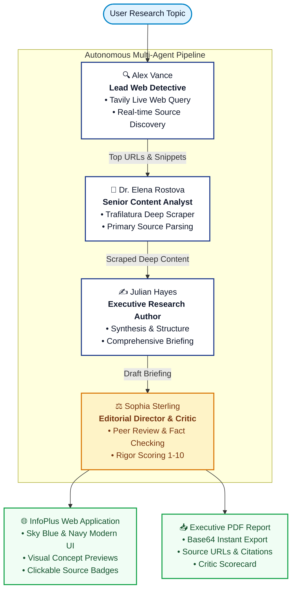

# InfoPlus · Autonomous AI Multi-Agent Research System

[](https://www.python.org/)
[](https://www.langchain.com/)
[](https://ai.google.dev/)
[](https://streamlit.io/)
[](https://tavily.com/)
[](LICENSE)

**InfoPlus** is an autonomous multi-agent research intelligence system designed with a collaborative **"agent-as-human"** workflow. Instead of a single LLM attempting to research, summarize, and critique simultaneously, InfoPlus assigns distinct specialized human agent personas that collaborate sequentially to discover real-time web intelligence, scrape authoritative whitepapers, draft structured executive briefings, and perform rigorous editorial peer review.

The frontend is built with a minimalist, iconic **Sky Blue & Navy Blue** aesthetic, offering real-time progress indicators, ChatGPT-style visual concept suggestions, clickable citation pills, and instant one-click downloadable **PDF** and **Markdown** reports.

---

## 🏛️ System Architecture



---

## 👥 Assigned Agent Personas

InfoPlus organizes agent tasks as specialized team roles to avoid hallucinations and maintain high research fidelity:

| Specialist | Role | Core Responsibility | Tools / Engine |
|---|---|---|---|
| 🔍 **Alex Vance** | Lead Web Detective | Scans live search engines for recent, credible articles and ranking URLs | `tavily-python`, LangChain Search Agent |
| 📖 **Dr. Elena Rostova** | Senior Content Analyst | Scrapes deep page content, cleans boilerplates, and isolates relevant text | `trafilatura`, `BeautifulSoup4`, `readability-lxml` |
| ✍️ **Julian Hayes** | Executive Author | Synthesizes raw findings into structured, multi-section executive briefings | Google Gemini (`gemini-2.5-flash`), Prompt Templates |
| ⚖️ **Sophia Sterling** | Editorial Director & Critic | Audits factual consistency, checks completeness, and assigns a rigor score | Google Gemini, Structured Editorial Review Chain |

---

## ⚡ Core Benefits & Capabilities

* **Autonomous Depth Over Surface Summaries:** Instead of relying on static training data, the pipeline conducts live web research and deep document scraping to retrieve fresh, factual sources.
* **Rigorous Peer Review:** The Critic agent audits the draft report against academic criteria and generates an audit score to ensure accuracy and eliminate bias.
* **Clickable Web Citations (ChatGPT Style):** Extracted URLs are parsed into clean source badges (`🔗 nature.com`, `🔗 arxiv.org`) that can be clicked directly from the briefing.
* **🎙️ Voice Recorder Input (Speech-to-Text):** Users can speak their research query directly into their microphone (`st.audio_input`). InfoPlus transcribes the audio and populates the search query automatically.
* **🔊 Spoken Executive Briefings (Audio Player):** Synthesizes a spoken executive summary with **Julian Hayes** using `gTTS`, allowing users to listen to the briefing directly in the browser.
* **ChatGPT-Style Visual Context:** Automatically matches research keywords with high-resolution visual context banners and concept galleries.
* **Robust PDF Export (`fpdf2`):** Pre-generates formatted executive PDFs with branding, agent signatures, full sections, and sources. Delivered via Base64 memory encoding to prevent server-side 404 download errors.

---

## 🛠️ Technologies Used

### Core Frameworks & LLMs
* **[Google Gemini](https://ai.google.dev/):** High-speed, multimodal LLM reasoning via `langchain-google-genai`.
* **[LangChain](https://www.langchain.com/):** Tool binding, agent orchestration, and prompt chain architecture.

### Research & Data Extraction
* **[Tavily Search API](https://tavily.com/):** Search engine built for autonomous LLM agents.
* **[Trafilatura](https://trafilatura.readthedocs.io/):** Precision web scraping and text extraction.
* **[BeautifulSoup4](https://www.crummy.com/software/BeautifulSoup/):** HTML DOM parsing and fallback document cleaning.

### UI & Document Generation
* **[Streamlit](https://streamlit.io/):** Responsive interactive web application.
* **Custom Design System:** Radiant sky-blue ambient gradient (`#f0f9ff` / `#e0f2fe`), crisp navy cards (`#0f172a`), and glassmorphism components.
* **[fpdf2](https://py-pdf.github.io/fpdf2/):** Programmatic PDF rendering with page-break and margin protection.
* **[Pillow](https://python-pillow.org/):** Image processing and asset formatting.

---

## 🚀 Installation & Setup

### 1. Prerequisites
* **Python 3.11**
* **Conda** or **venv**
* API Keys for:
  - [Google Gemini AI Studio](https://aistudio.google.com/)
  - [Tavily Search](https://tavily.com/)

---

### 2. Clone the Repository
```bash
git clone https://github.com/Mithun-Mh/Multi-Agent-Research-System.git
cd Multi-Agent-Research-System
```

---

### 3. Create & Activate Virtual Environment

**Using Conda (Recommended):**
```bash
conda create -n langagent python=3.11 -y
conda activate langagent
```

**Using Python venv:**
```bash
python -m venv .venv
# On Windows:
.venv\Scripts\activate
# On Linux / macOS:
source .venv/bin/activate
```

---

### 4. Install Dependencies
```bash
pip install -r requirements.txt
```

---

### 5. Configure Environment Variables
Create a `.env` file in the project root directory:
```bash
# Windows PowerShell:
New-Item -ItemType File -Name .env
```

Populate `.env` with your API credentials:
```env
# Google Gemini API Key
GEMINI_API_KEY="your-google-gemini-api-key"
GOOGLE_API_KEY="your-google-gemini-api-key"

# Tavily Web Search API Key
TAVILY_API_KEY="your-tavily-search-api-key"
```

---

## 🖥️ Running the Application

### Option A: Interactive Web UI (Streamlit)
```bash
streamlit run app.py
```
Open **`http://localhost:8501`** in your browser. Enter any topic or click a suggested prompt and press **⚡ Let's Search**.

### Option B: Terminal / CLI Mode
To run the research pipeline directly from the command line:
```bash
python main.py
```

---

## 📁 Project Structure

```plaintext
Multi-Agent-Research-System/
│
├── app.py                     # Streamlit frontend (Sky Blue & Navy theme, PDF export)
├── main.py                    # CLI entrypoint for running the research pipeline
├── requirements.txt           # Project dependencies
├── README.md                  # System documentation & setup guide
├── .env                       # API keys (Tavily & Google Gemini)
│
└── src/
    ├── agents/
    │   ├── __init__.py
    │   └── agent.py           # Search Agent, Reader Agent, Writer Chain & Critic Chain
    ├── pipelines/
    │   ├── __init__.py
    │   └── pipeline.py        # 4-Step sequential autonomous research coordinator
    └── tools/
        ├── __init__.py
        └── tools.py           # Tavily web search tool and Trafilatura URL scraper
```

---

## 📄 License
This project is open-source under the [MIT License](LICENSE).